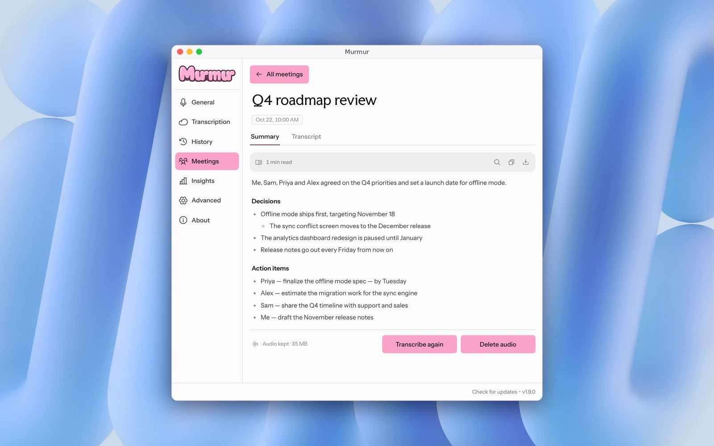
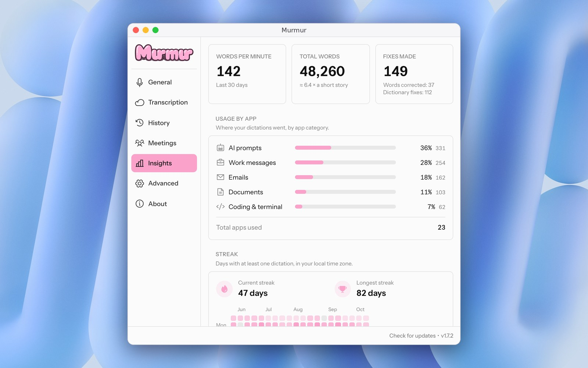

# Murmur

<p align="center">
  <a href="https://github.com/DailyXplorer/Murmur/releases/latest"></a>
  <a href="https://github.com/DailyXplorer/Murmur/releases"></a>
  
  <a href="LICENSE"></a>
  <a href="https://github.com/DailyXplorer/Murmur/stargazers"></a>
</p>

<p align="center">
  
  
</p>

Murmur is a free desktop speech-to-text app for macOS and Windows (beta). Press a shortcut, speak, and
Murmur pastes the transcription into the active application.

On the Mac, Murmur transcribes locally: the audio stays on your Mac, there is
no quota, and no account is needed. Connect a ChatGPT account (through Codex)
to add AI cleanup, more languages and cloud transcription. It requires no API
key.

## Requirements

### macOS

- macOS 10.15 or later
- A working microphone
- Codex signed in with a ChatGPT account, for cloud transcription, AI cleanup
  and meetings. Local transcription, the default, runs without it. A Mac that
  cannot run the local model needs it to finish setup.
- Accessibility permission for global shortcuts and text insertion
- For local transcription: macOS 15 or later on Apple silicon, or an Intel
  Mac, and a one-time download of about 500 MB (740 MB on Intel)
- For meetings with system audio: macOS 14.4 or later on Apple silicon, and
  the System Audio Recording permission
- Network access for cloud transcription and AI cleanup

### Windows (beta)

- Windows 10 or 11, x64
- A working microphone
- Codex signed in with a ChatGPT account
- Network access while transcribing

For Codex, Murmur reads the authentication cache from `CODEX_HOME/auth.json`,
or else `~/.codex/auth.json` on macOS and `%USERPROFILE%\.codex\auth.json` on
Windows. When the access token is about to expire, or when the
service rejects it, Murmur refreshes the session the same way the Codex CLI
does and writes the new tokens back to that file. It changes only the token
fields and `last_refresh`, keeps the file private (mode 600), and replaces it
in one step. If Codex updated the file while Murmur was refreshing, Murmur
keeps the Codex version. When the refresh token itself has expired, sign in to
Codex again.

### Private interfaces

Murmur uses an internal service rather than a public, documented API: the
ChatGPT transcription endpoint that the Codex apps use. It promises no
stability, so a Codex or ChatGPT update can break transcription without notice
until Murmur is updated. Murmur identifies itself to the transcription endpoint the
way the Codex desktop app does. Use of these services stays subject to the
provider's terms for your account.

## Install

### macOS

1. Download the DMG from the latest
   [GitHub release](https://github.com/DailyXplorer/Murmur/releases/latest):
   `aarch64` for Apple Silicon, `x64` for Intel.
2. Open the DMG and drag Murmur to Applications.
3. Open Murmur. Releases are signed with a stable self-signed certificate but
   are not notarized by Apple, so macOS blocks the first launch. Open System
   Settings → Privacy & Security and click **Open Anyway**. Since macOS 15,
   right-click → Open no longer bypasses this check.
4. Grant Microphone and Accessibility access when Murmur asks.

Murmur's built-in updater installs releases signed with the same certificate,
so macOS keeps both permissions and asks nothing again after an update. Murmur
does not store anything in the keychain.

### Windows (beta)

1. Open the [Windows releases](https://github.com/DailyXplorer/Murmur/releases?q=Murmur%20for%20Windows&expanded=true)
   and download `Murmur_…_x64-setup.exe` from the first one in the list.
2. Run the installer. It is not signed, so SmartScreen blocks it: click
   **More info**, then **Run anyway**. Murmur installs for the current user.
3. Open Murmur and connect Codex. Hold Ctrl+Win to dictate, or double-tap it
   to record hands-free.

The Windows source lives on the `beta` branch for now, not on `main`.

## Features

- One recording shortcut (Option+Space by default, Ctrl+Win on Windows): hold it to talk, or double-tap it to record hands-free and press it once to stop
- A cancel shortcut (Escape by default), active only while Murmur records or transcribes
- A shortcut (Control+Command+V by default) and tray item that paste the latest transcription again
- Transcription on this Mac or in the cloud, chosen in Settings →
  Transcription. On the Mac, NVIDIA Parakeet TDT 0.6B v3 covers 25 European
  languages with no quota. When it can't serve a dictation (model not
  downloaded yet, failure, another language), Murmur uses the cloud if
  ChatGPT is connected; when ChatGPT refuses in cloud mode, a downloaded model
  takes over. History marks each such dictation.
- When no text field is focused, nothing is pasted or copied; the overlay
  offers a Copy button that puts the text on the clipboard
- Automatic language detection, or an explicit dictation language
- Microphone and output-device selection
- AI cleanup through the Codex session, on by default: removes fillers,
  applies self-corrections, fixes punctuation, and formats lists and spoken
  line breaks. Any failure or timeout pastes the raw transcript.
- A dictionary that also learns names you correct right after pasting
- Names from the frontmost window as spelling hints for AI cleanup, read
  through Accessibility and never stored
- Automatic level boost for quiet speech, and a Whisper mode for very quiet speech
- Transcription history with saved recordings, keeping the raw and cleaned text; a failed
  or unsatisfying transcription can be sent again from its recording
- Insights: total words, words per minute over the last 30 days, current and
  longest streak with a 20-week heatmap, and usage by app category
- Meetings: record a call (Control+Option+Command+M or the menu bar), then
  get a transcript with speakers told apart and a summary with a title. See
  [Meetings](#meetings)
- A minimal waveform overlay at the top or bottom of the screen, which can be
  turned off
- Audio feedback, tray controls, and automatic updates

The Windows beta has dictation, Codex transcription and AI cleanup, history,
Insights, custom words, sounds, and launch at login. It does not have
Meetings, correction learning, names read from the focused window, or
automatic updates yet.

## Getting started

Setup first offers to transcribe on this Mac. **Download and continue** starts
the model's download in the background, so it runs while you grant microphone
and Accessibility permissions; a small pill shows its progress until the model
is ready. **Use the cloud instead** keeps the model off this Mac. A Mac that
cannot run the model skips this step.

Then connect Codex. If no session is found, open Codex, sign in there, and
return to Murmur to refresh its status. The setup screen links to the Codex
download page. With local transcription this step is optional: **Skip** it to
dictate without an account, without AI cleanup and the cloud's extra
languages. With cloud transcription, Codex must be configured before setup
can finish. Until the model is ready, a connected account transcribes in the
cloud; without one, dictation waits for the model.

"Configured" means Murmur found a local session that is valid or that it can
refresh. A Codex session that expired and has no usable refresh token shows as
"Session expired". Configured does not prove that the cloud service will
accept the next request, because network or account limits can still prevent
transcription.

When a dictation fails, the recording overlay shows the reason for a few
seconds. If the overlay is turned off, Murmur posts a macOS notification
instead. Murmur retries a dictation twice after a timeout, a dropped
connection, or a server error. It does not retry an expired session, a rate
limit, or another rejected request. When Codex reports that its dictation
usage limit is reached, Murmur resends the recording at once against
ChatGPT's own dictation limit, and uses that limit for the next hour. A
finished transcription is always kept
in History, even when pasting or saving the recording fails.

Recordings longer than about 13 minutes exceed 25 MB of audio. The Codex
transcription endpoint publishes no size limit, and the public OpenAI
transcription API rejects uploads above 25 MB, so Murmur warns before it
uploads a recording of that size. The upload timeout grows with the recording
length.

### Meetings

Meetings are on by default and can be turned off in Settings → Advanced.
Press Control+Option+Command+M, or choose Start meeting in the menu bar, to
start recording; press it again to stop. You can pick other keys in Settings;
if another app already holds them, the shortcut field says so. A red pill
shows the elapsed time. A meeting stops by itself after 3 hours, with a
warning 5 minutes before.

- Murmur records two tracks: your microphone ("Me") and the system audio,
  which holds the other participants. System audio needs macOS 14.4 or later
  on Apple silicon, and the System Audio Recording permission, which macOS
  asks for at the first meeting. Without it, meetings record the microphone
  only. When another app played sound during a meeting but its system audio
  holds nothing but silence while you spoke, the meeting says so and links
  to the privacy settings.
- After you stop, Codex transcribes the tracks in pieces of up to 10 minutes,
  at most 3 at a time. Processing resumes after a quit, without sending a
  transcribed piece again. Pieces Codex refuses are transcribed on the Mac
  when the local model is downloaded, and the meeting says so.
- On Apple silicon with macOS 15 or later, speaker detection runs on the Mac
  with [FluidAudio](https://github.com/FluidInference/FluidAudio). Its models
  are the local transcription download, fetched during the first meeting if
  they aren't there yet. Without them, or on
  macOS 14, where FluidAudio's speaker model crashes, each track keeps one
  speaker.
- Once the transcript is complete, Codex writes a title and a summary. The
  two tracks are then kept as one compressed `audio.m4a` (about 30 MB per
  hour), which you can delete while keeping the text.
- Murmur warns at the start of a meeting when less than 1.5 GB is free on
  the disk. Three hours take about 700 MB before compression.

### Permissions after updating to the stable signature

Releases are signed with a stable Murmur certificate, so macOS keeps the
Accessibility and microphone permissions from one update to the next. Earlier
releases were signed ad hoc. After the first update from an ad hoc release,
grant Accessibility and microphone access to Murmur once more. If the
Accessibility switch already looks enabled but Murmur keeps waiting, use the
repair button on the permissions screen, or follow the reset steps in
[BUILD.md](BUILD.md#macos-accessibility-remains-enabled-after-a-local-rebuild).

Cancel stops a transcription before its result is inserted. If the text has
already been pasted, cancellation still prevents a pending automatic Enter.
The pasted text and its history entry remain available.

## CLI

```bash
murmur --toggle-transcription
murmur --cancel
murmur --start-hidden
murmur --no-tray
murmur --debug
murmur --transcribe-file recording.wav --json
```

On Unix systems, `SIGUSR2` also toggles transcription for a running instance:

```bash
pkill -USR2 -n murmur
```

## Development

Prerequisites: the latest stable Rust toolchain and Bun.

```bash
bun install
bun run tauri dev
bun run build
bun run lint
bun run format:check
cargo test --manifest-path src-tauri/Cargo.toml
```

See [BUILD.md](BUILD.md) for macOS dependencies, packaging, code signing, and
notarization.

## Architecture

Murmur uses Tauri 2 with a Rust backend and a React/TypeScript frontend. The
runtime pipeline is:

```text
microphone -> quiet-speech gain -> local (Parakeet) or Codex transcription -> dictionary -> AI cleanup (Codex) -> clipboard/paste
```

The backend owns audio capture, the Codex session and its refresh, transcription,
AI cleanup, history, Insights, shortcuts, and macOS integration. The frontend owns onboarding, settings, history, Insights, and the recording
overlay.

## Privacy and security

In local mode your audio stays on this Mac. If ChatGPT is connected, the text
(not the audio) is sent for AI cleanup, and audio goes to the cloud only when
the local model can't help; History marks those. In cloud mode, audio sent for
transcription leaves the computer and is handled by ChatGPT. Do not describe
Murmur as offline while AI cleanup or the cloud fallback can run.

While AI cleanup is on, the transcript is sent to ChatGPT for cleanup. A
cleanup request contains the transcript, your custom dictionary words, and the
names found in the frontmost window.

Those names are read on the Mac through Accessibility when a dictation starts,
only while AI cleanup and the window-names setting are both on. They are never
stored, and they leave the Mac only inside a Codex cleanup request. Password
fields and password managers are never read.

Meetings stay on the Mac, apart from two requests: the audio pieces sent to
Codex for transcription, and the transcript sent to Codex for the summary.
Speaker detection runs on the Mac. Its models are downloaded from Hugging
Face once.

History, saved recordings, learned words, and Insights stay on the Mac.
For Insights, Murmur records the frontmost app of each dictation and, in a
browser, the site's host name. Insights store no dictated text. Murmur checks GitHub for updates, which can be
turned off in Settings.

The Codex authentication cache is sensitive. Murmur reads the tokens needed
for a request or a refresh, never logs them, and keeps no copy of its own.
The only write is the token refresh described in
[Requirements](#requirements).

Guarded paste saves the clipboard before it places the transcription there.
By default, Murmur puts the saved items back, with every format they had, once
the 8-second paste window ends. If you copy something else during that window,
Murmur leaves your new clipboard alone. If insertion fails, Murmur keeps the
transcription on the clipboard for manual paste. The Keep transcription option
leaves the transcription on the clipboard after insertion.

## Origin

Murmur is a fork of [Handy](https://github.com/cjpais/Handy), created by CJ
Pais. It keeps parts of Handy's Tauri foundation, but most of Handy's original
transcription engine and local-model stack have been removed. Murmur
transcribes through Codex using the session already present on the computer,
or on the Mac with Parakeet: FluidAudio on Apple silicon, and on Intel Macs
transcribe.cpp, the engine Handy uses.

## Support

Murmur is free. To support development,
[buy a coffee](https://buymeacoffee.com/dailyxplorer).

## License

MIT. See [LICENSE](LICENSE). The original copyright notice is preserved as
required by the license.
