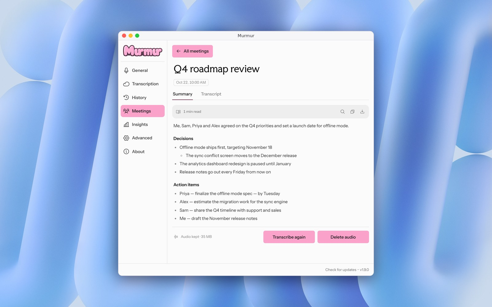
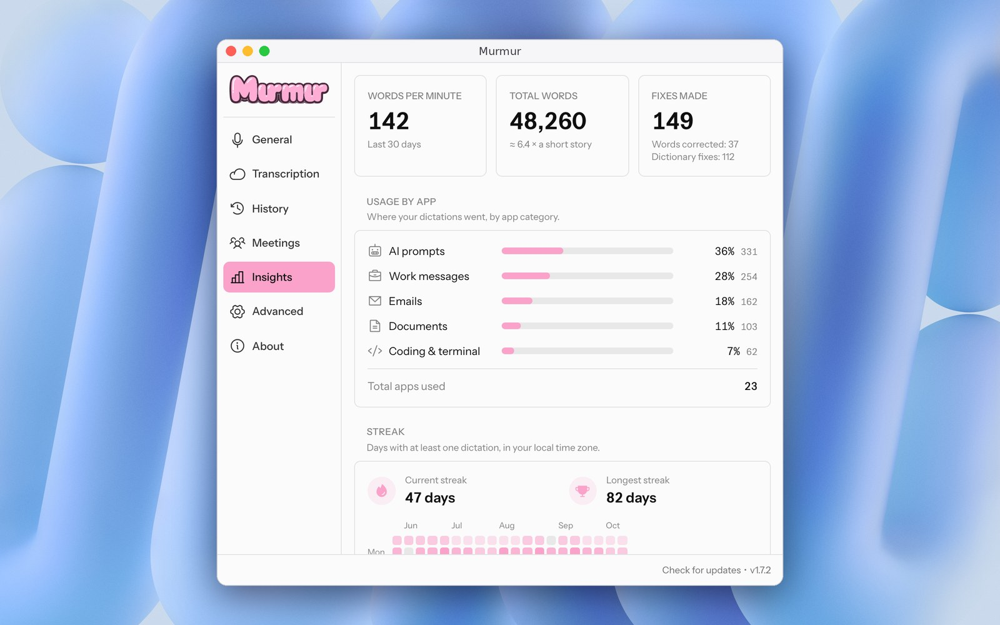

# Murmur

<p align="center">
  <a href="https://github.com/DailyXplorer/Murmur/releases/latest"></a>
  <a href="https://github.com/DailyXplorer/Murmur/releases"></a>
  
  <a href="LICENSE"></a>
  <a href="https://github.com/DailyXplorer/Murmur/stargazers"></a>
</p>

<p align="center">
  
  
</p>

Murmur is a free desktop speech-to-text app for macOS and Windows (beta). Press a shortcut, speak, and
Murmur pastes the transcription into the active application.

Murmur transcribes on your computer: the audio stays there, there is no
quota, and no account is needed. Sign in with a ChatGPT account from Murmur to
add AI cleanup, dictation styles, more languages and cloud transcription. It
requires no API key and no separate Codex app.

## Requirements

### macOS

- macOS 10.15 or later
- A working microphone
- A ChatGPT account, signed in from Murmur, for cloud transcription, AI
  cleanup and meetings. Local transcription, the default, runs without it. A
  Mac that cannot run the local model needs it to finish setup.
- Accessibility permission for global shortcuts and text insertion
- For local transcription: macOS 15 or later on Apple silicon, or an Intel
  Mac, and a one-time download of about 500 MB (740 MB on Intel)
- For meetings with system audio: macOS 14.4 or later on Apple silicon, and
  the System Audio Recording permission
- Network access for cloud transcription and AI cleanup

### Windows (beta)

- Windows 10 or 11, x64
- A working microphone
- For local transcription: a one-time download of about 740 MB
- A ChatGPT account, signed in from Murmur, for cloud transcription and AI
  cleanup. Local transcription runs without it.
- Network access for cloud transcription and AI cleanup

Murmur keeps the ChatGPT session in the file the Codex apps use, so both share
one sign-in: `CODEX_HOME/auth.json`,
or else `~/.codex/auth.json` on macOS and `%USERPROFILE%\.codex\auth.json` on
Windows. When the access token is about to expire, or when the
service rejects it, Murmur refreshes the session the same way the Codex CLI
does and writes the new tokens back to that file. It changes only the token
fields and `last_refresh`, keeps the file private (mode 600), and replaces it
in one step. If Codex updated the file while Murmur was refreshing, Murmur
keeps the Codex version. When the refresh token itself has expired, sign in
again from Murmur.

### Private interfaces

Murmur uses an internal service rather than a public, documented API: the
ChatGPT transcription endpoint that the Codex apps use. It promises no
stability, so a Codex or ChatGPT update can break transcription without notice
until Murmur is updated. Murmur identifies itself to the transcription endpoint the
way the Codex desktop app does. Use of these services stays subject to the
provider's terms for your account.

## Install

### macOS

1. Download the DMG from the latest
   [GitHub release](https://github.com/DailyXplorer/Murmur/releases/latest):
   `aarch64` for Apple Silicon, `x64` for Intel.
2. Open the DMG and drag Murmur to Applications.
3. Open Murmur. Releases are signed with a stable self-signed certificate but
   are not notarized by Apple, so macOS blocks the first launch. Open System
   Settings → Privacy & Security and click **Open Anyway**. Since macOS 15,
   right-click → Open no longer bypasses this check.
4. Grant Microphone and Accessibility access when Murmur asks.

Murmur's built-in updater installs releases signed with the same certificate,
so macOS keeps both permissions and asks nothing again after an update. Murmur
does not store anything in the keychain.

### Windows (beta)

1. Open the [Windows releases](https://github.com/DailyXplorer/Murmur/releases?q=Murmur%20for%20Windows&expanded=true)
   and download `Murmur_…_x64-setup.exe` from the first one in the list.
2. Run the installer. It is not signed, so SmartScreen blocks it: click
   **More info**, then **Run anyway**. Murmur installs for the current user.
3. Open Murmur, download the speech model or sign in with ChatGPT. Hold
   Ctrl+Win to dictate, or double-tap it to record hands-free.

Windows is a beta: it shares this repository and its version number with the Mac app.

Murmur for Windows updates itself: the footer offers each new version, which
installs with a progress bar and no administrator prompt, and Murmur comes back
by itself. **Check for updates** in the footer or the tray menu looks right
away, and Settings, Advanced, Updates turns the automatic checks off. Beta 6
and older have no updater, so install a newer build by hand once, as above.

## Features

- One recording shortcut (Option+Space by default, Ctrl+Win on Windows): hold it to talk, or double-tap it to record hands-free and press it once to stop
- A cancel shortcut (Escape by default), active only while Murmur records or transcribes
- Restore after a cancel: for 60 seconds, the overlay's Restore button (shown 5 seconds) or the tray's "Restore cancelled dictation" transcribes the cancelled dictation and pastes it where you are now
- A shortcut (Control+Command+V by default) and tray item that paste the latest transcription again
- Transcription on this Mac or in the cloud, chosen in Settings →
  Transcription. On the Mac, Parakeet Ultra (Moondream's post-trained NVIDIA
  Parakeet TDT 0.6B v3) covers 25 European
  languages with no quota. When it can't serve a dictation (model not
  downloaded yet, failure, another language), Murmur uses the cloud if
  ChatGPT is connected; when ChatGPT refuses in cloud mode, a downloaded model
  takes over. History marks each such dictation. After a macOS update, the
  first launch compiles the model for the new version in the background.
- When no text field is focused, nothing is pasted or copied; the overlay
  offers a Copy button that puts the text on the clipboard
- Automatic language detection, or an explicit dictation language
- Microphone and output-device selection
- AI cleanup through your ChatGPT account, on by default: removes fillers,
  applies self-corrections, fixes punctuation, and formats lists and spoken
  line breaks. Any failure or timeout pastes the raw transcript.
- Short dictations, under 20 words, are pasted right away without AI cleanup
  unless you chose a Formal or Casual style or turned on "Also clean up short
  dictations"
- Instant fixes on English and French dictations, without AI: hesitations
  (um, uh, euh) removed, and "new line", "new paragraph" or "à la ligne" turned
  into breaks; spoken punctuation ("comma", "question mark", "virgule") too
  when AI cleanup did not run
- Dictation styles for cleanup: Formal, Normal (the default) or Casual
- A dictionary of custom words, spelled your way in each dictation
- A space added when you dictate right after a word, so the text does not stick
  to it. It never reads password fields or a selection, and adds nothing in an
  app that does not show where the cursor is. Settings → Transcription → Add
  leading space
- Names from the frontmost window and a short excerpt around the cursor as
  hints for AI cleanup, read through Accessibility (UI Automation on Windows)
  and never stored; password fields and password managers are never read
- Automatic level boost for quiet speech, and a Whisper mode for very quiet speech
- Transcription history with saved recordings, keeping the raw and cleaned text; a failed
  or unsatisfying transcription can be sent again from its recording
- Insights: total words, words per minute over the last 30 days, current and
  longest streak with a 20-week heatmap, and usage by app category
- Meetings: record a call (Control+Option+Command+M or the menu bar), read
  it live while it records, then get a transcript with speakers told apart
  and a summary with a title. See [Meetings](#meetings)
- Call prompts: Murmur offers to record a call when a call app takes the
  microphone, and to stop and transcribe when the call ends during a meeting
- Search across every meeting (titles, summaries, transcripts) and every
  dictation, ignoring case and accents; each word matches as a prefix, and
  quotes match an exact phrase. Opening a meeting from a result jumps to the
  first passage that matched
- Let an AI assistant such as Claude Code, Codex or Claude Desktop read your
  meetings, read-only and off until you turn it on. See
  [Use your meetings from an AI assistant](#use-your-meetings-from-an-ai-assistant)
- A small orb overlay at the top or bottom of the screen, which can be
  turned off
- Audio feedback, tray controls, and automatic updates

The Windows beta has dictation, transcription on the PC or in the cloud, AI
cleanup with styles, names read from the active window, history you can search
by words, Insights, custom words, a space added after a word, shortcut keys
shown for your keyboard layout, sounds, launch at login, and read-only access to
your dictation history for AI assistants, and it updates itself. It does not
have Meetings yet.

## Getting started

Setup first offers to transcribe on this Mac. **Download and continue** starts
the model's download in the background, so it runs while you grant microphone
and Accessibility permissions; a small pill shows its progress until the model
is ready. **Use the cloud instead** keeps the model off this Mac. A Mac that
cannot run the model skips this step.

Then connect ChatGPT: **Sign in** finishes in your browser. If the Codex app
is already signed in on this computer, Murmur uses that session. With local
transcription this step is optional: **Skip** it to dictate without an
account, without AI cleanup and the cloud's extra languages. With cloud
transcription, ChatGPT must be connected before setup can finish. Until the model is ready, a connected account transcribes in the
cloud; without one, dictation waits for the model.

"Configured" means Murmur found a local session that is valid or that it can
refresh. A session that expired and has no usable refresh token shows as
"Session expired". Configured does not prove that the cloud service will
accept the next request, because network or account limits can still prevent
transcription.

When a dictation fails, the recording overlay shows the reason for a few
seconds. If the overlay is turned off, Murmur posts a macOS notification
instead. Murmur retries a dictation twice after a timeout, a dropped
connection, or a server error. It does not retry an expired session, a rate
limit, or another rejected request. When Codex reports that its dictation
usage limit is reached, Murmur resends the recording at once against
ChatGPT's own dictation limit, and uses that limit for the next hour. A
finished transcription is always kept
in History, even when pasting or saving the recording fails.

Recordings longer than about 13 minutes exceed 25 MB of audio. The Codex
transcription endpoint publishes no size limit, and the public OpenAI
transcription API rejects uploads above 25 MB, so Murmur warns before it
uploads a recording of that size. The upload timeout grows with the recording
length.

### Meetings

Meetings are on by default and can be turned off in Settings → Advanced.
Press Control+Option+Command+M, or choose Start meeting in the menu bar, to
start recording; press it again to stop. You can pick other keys in Settings;
if another app already holds them, the shortcut field says so. A red pill
shows the elapsed time. A meeting stops by itself after 3 hours, with a
warning 5 minutes before.

- Murmur records two tracks: your microphone ("Me") and the system audio,
  which holds the other participants. System audio needs macOS 14.4 or later
  on Apple silicon, and the System Audio Recording permission, which macOS
  asks for at the first meeting. Without it, meetings record the microphone
  only. When another app played sound during a meeting but its system audio
  holds nothing but silence while you spoke, the meeting says so and links
  to the privacy settings.
- While a meeting records, open it in Meetings to read a live transcript, a
  few seconds behind speech, with "You" for the microphone and "Others" for
  system audio. It is made on the Mac by the local model, never in the cloud,
  and a dictation always goes first. Without the local model, the meeting
  view says so and the transcript is made after Stop as usual. The "Paste new
  meeting text" shortcut, unbound until you pick keys under Meetings, pastes
  what was said since its last use. The live transcript is a draft: the
  transcript made after Stop replaces it. Turn it off in Settings → Advanced.
- After you stop, Codex transcribes the tracks in pieces of up to 10 minutes,
  at most 3 at a time. Processing resumes after a quit, without sending a
  transcribed piece again. Pieces Codex refuses are transcribed on the Mac
  when the local model is downloaded, and the meeting says so.
- On Apple silicon with macOS 15 or later, speaker detection runs on the Mac
  with [FluidAudio](https://github.com/FluidInference/FluidAudio). Its models
  are the local transcription download, fetched during the first meeting if
  they aren't there yet. Without them, or on
  macOS 14, where FluidAudio's speaker model crashes, each track keeps one
  speaker.
- Once the transcript is complete, Codex writes a title and a summary. The
  two tracks are then kept as one compressed `audio.m4a` (about 30 MB per
  hour), which you can delete while keeping the text. Deleting a meeting, or
  its audio, moves it to the macOS Trash with the transcript as a Markdown
  file, so you can still open it without Murmur. Audio you set to delete
  after some days is erased for good.
- Murmur warns at the start of a meeting when less than 1.5 GB is free on
  the disk. Three hours take about 700 MB before compression.
- On Apple silicon with macOS 14 or later, when a call app (Zoom, Teams,
  Slack, FaceTime, Webex, Discord, or a meeting page in a browser) holds the
  microphone for 3 seconds, a panel asks whether to record the call. During
  a meeting, once every call app it heard has left the microphone for 3
  seconds, the panel says the call ended and offers **Stop and transcribe**
  or **Keep recording**. Murmur never stops a meeting without your answer:
  unanswered, the panel stays and the meeting goes on. Keep recording asks
  again only if a call comes back and leaves again. **Offer to record calls**
  in Settings > Advanced turns both off.

### Use your meetings from an AI assistant

An AI assistant that supports the Model Context Protocol can list, search and
read your meetings: "what did we decide about pricing last week?". It is off
until you turn on "Let AI agents read your meetings (MCP)" in Settings →
Advanced, which then shows what to paste into Claude Code, Codex or Claude
Desktop. For Claude Code, for example:

```bash
claude mcp add murmur -- /Applications/Murmur.app/Contents/MacOS/murmur mcp
```

- The assistant starts `murmur mcp` itself and talks to it through the
  process's standard input and output. Murmur opens no window and no network
  port for it, and nothing else on your Mac or the internet can reach it.
- It is read-only: it opens your meetings with read-only access, offers no
  tool that changes anything and takes no file path. It never returns audio,
  audio paths, window names, settings or account data.
- Five tools: `list_meetings`, `search`, `get_transcript`, `get_summary`, and
  `recent_dictations`. The last exists only when you also turn on "Include
  dictation history", which is off by default because dictations are more
  personal than meetings.
- Whatever the assistant reads goes to the assistant's own servers, not only
  to your Mac. Turn the switch off to stop it; this takes effect on the next
  request, without restarting the assistant.
- If Murmur was updated and not opened since, open it once: the server never
  changes your data to catch up.

On Windows the assistant has the same five tools. Meetings are not available
on Windows yet, so the meeting tools find nothing there, and it reads your
dictation history through `search` and `recent_dictations`. They are off until
you turn on "Let AI agents connect (MCP)" and then "Include dictation history"
in Settings → Advanced. Settings shows
the command with the real path of your `murmur.exe`. For Claude Code, for
example, in PowerShell or cmd (keep the quotes if the path holds spaces):

```bash
claude mcp add murmur -- "C:\Users\you\AppData\Local\Murmur\murmur.exe" mcp
```

The server reads `settings_store.json` and `history.db` in
`%APPDATA%\com.dailyxplorer.murmur`. Running `murmur.exe mcp` by hand in a
terminal shows nothing: the Windows app has no console, so the server talks
only through the pipes the assistant gives it.

### Permissions after updating to the stable signature

Releases are signed with a stable Murmur certificate, so macOS keeps the
Accessibility and microphone permissions from one update to the next. Earlier
releases were signed ad hoc. After the first update from an ad hoc release,
grant Accessibility and microphone access to Murmur once more. If the
Accessibility switch already looks enabled but Murmur keeps waiting, use the
repair button on the permissions screen, or follow the reset steps in
[BUILD.md](BUILD.md#macos-accessibility-remains-enabled-after-a-local-rebuild).

Cancel stops a transcription before its result is inserted. If the text has
already been pasted, cancellation still prevents a pending automatic Enter.
The pasted text and its history entry remain available.

## CLI

```bash
murmur --toggle-transcription
murmur --cancel
murmur --start-hidden
murmur --no-tray
murmur --debug
murmur --transcribe-file recording.wav --json
murmur mcp
```

`murmur mcp` (`murmur.exe mcp` on Windows) is for AI assistants to launch, not to run by hand; see
[Use your meetings from an AI assistant](#use-your-meetings-from-an-ai-assistant).

On Unix systems, `SIGUSR2` also toggles transcription for a running instance:

```bash
pkill -USR2 -n murmur
```

## Development

Prerequisites: the latest stable Rust toolchain and Bun.

```bash
bun install
bun run tauri dev
bun run build
bun run lint
bun run format:check
cargo test --manifest-path src-tauri/Cargo.toml
```

See [BUILD.md](BUILD.md) for macOS dependencies, packaging, code signing, and
notarization.

## Architecture

Murmur uses Tauri 2 with a Rust backend and a React/TypeScript frontend. The
runtime pipeline is:

```text
microphone -> quiet-speech gain -> local (Parakeet) or Codex transcription -> dictionary -> text passes -> AI cleanup (Codex, 20 words or more) -> clipboard/paste
```

The backend owns audio capture, the Codex session and its refresh, transcription,
AI cleanup, history, Insights, shortcuts, and macOS integration. The frontend owns onboarding, settings, history, Insights, and the recording
overlay.

## Privacy and security

In local mode your audio stays on this Mac. If ChatGPT is connected, the text
(not the audio) is sent for AI cleanup, and audio goes to the cloud only when
the local model can't help; History marks those. In cloud mode, audio sent for
transcription leaves the computer and is handled by ChatGPT. Do not describe
Murmur as offline while AI cleanup or the cloud fallback can run.

While AI cleanup is on, the transcript is sent to ChatGPT for cleanup, except
for a short dictation that the default cleanup skips. A
cleanup request contains the transcript, your custom dictionary words, your
dictation style, and the names and short excerpt around the cursor found in the
frontmost window.

That context is read when a dictation starts, through Accessibility on the Mac
and UI Automation on Windows, only while AI cleanup and the window-context
setting are both on. It is never stored, and it leaves the computer only inside
a cleanup request. Password fields and password managers are never read.

Meetings stay on the Mac, apart from two requests: the audio pieces sent to
Codex for transcription, and the transcript sent to Codex for the summary.
Speaker detection runs on the Mac. Its models are downloaded from Hugging
Face once. An AI assistant you connect through `murmur mcp` reads meetings on
the Mac, but what it reads is then sent to its own servers.

The audio of a cancelled dictation stays in memory for 60 seconds for Restore,
and is never written to disk. It is overwritten with zeros when the minute
ends, when a new recording starts, or when Murmur quits.

History, saved recordings, and Insights stay on the Mac.
For Insights, Murmur records the frontmost app of each dictation and, in a
browser, the site's host name. Insights store no dictated text. Murmur checks GitHub for updates, which can be
turned off in Settings.

The Codex authentication cache is sensitive. Murmur reads the tokens needed
for a request or a refresh, never logs them, and keeps no copy of its own.
The only write is the token refresh described in
[Requirements](#requirements).

Guarded paste saves the clipboard before it places the transcription there.
By default, Murmur puts the saved items back, with every format they had, once
the 8-second paste window ends. If you copy something else during that window,
Murmur leaves your new clipboard alone. If insertion fails, Murmur keeps the
transcription on the clipboard for manual paste. The Keep transcription option
leaves the transcription on the clipboard after insertion.

## Origin

Murmur is a fork of [Handy](https://github.com/cjpais/Handy), created by CJ
Pais. It keeps parts of Handy's Tauri foundation, but most of Handy's original
transcription engine and local-model stack have been removed. Murmur
transcribes in the cloud through your ChatGPT account, or on the computer with
Parakeet: FluidAudio on Apple silicon, and transcribe.cpp, the engine Handy
uses, on Intel Macs and Windows.

## Support

Murmur is free. To support development,
[buy a coffee](https://buymeacoffee.com/dailyxplorer).

## License

MIT. See [LICENSE](LICENSE). The original copyright notice is preserved as
required by the license.
